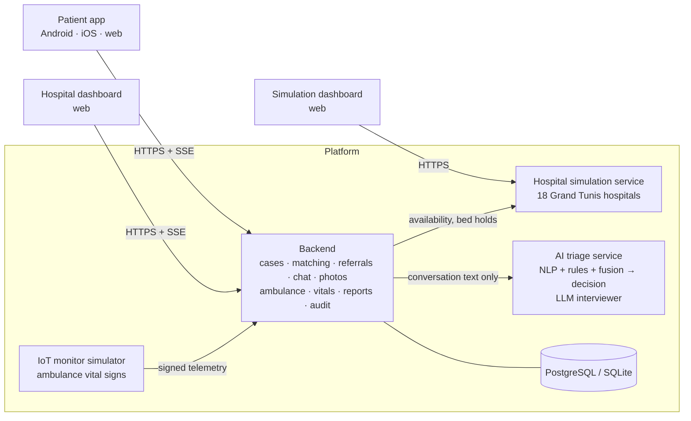
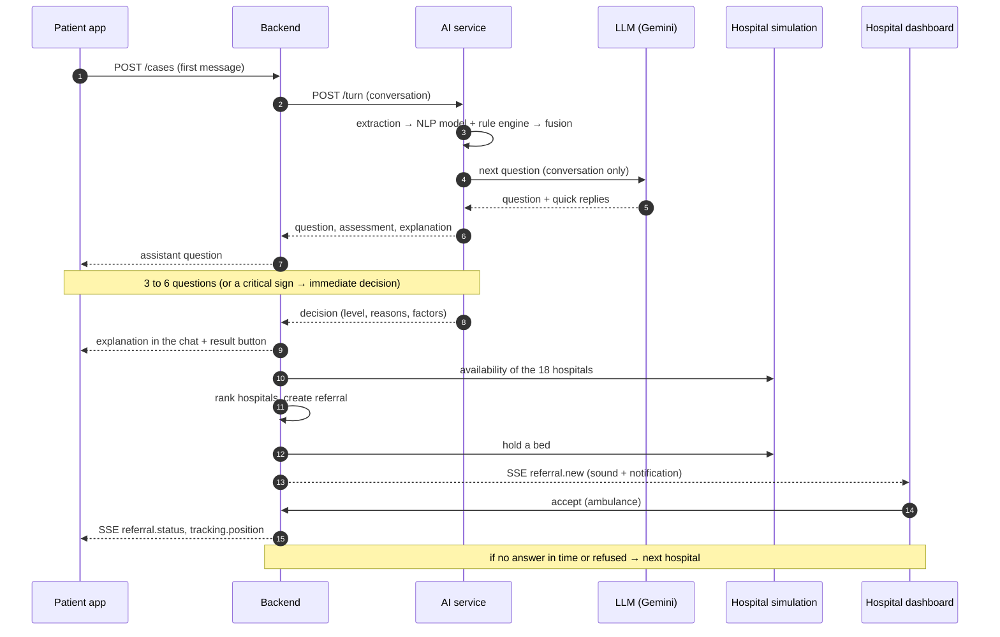
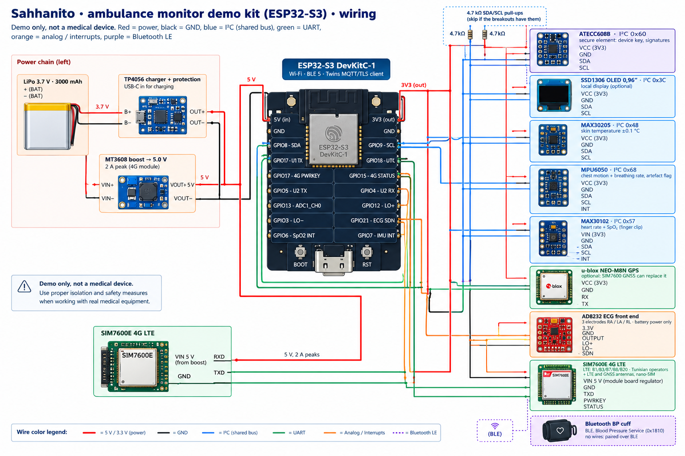

# Sahhanito · صحة نيتو

**AI emergency triage and hospital orientation for Grand Tunis.**

A patient (or someone with them) describes the problem in their own words, in **Tunisian Darija (Arabic letters or Arabizi), Modern Standard Arabic, French or English**. Sahhanito asks a few questions, decides how urgent it is, explains why, finds the most suitable hospital that can take the patient *now*, alerts that hospital, and keeps the patient and the emergency department in direct contact until arrival, with live tracking of the ambulance and of the patient's vital signs on the way.

> **Prototype.** Triage rules, model weights and translations are not clinically validated; hospital availability, ambulances and vital-sign monitors are simulated. In an emergency, call **190** (SAMU).

---

## Contents

1. [How it works](#1-how-it-works)
2. [Architecture](#2-architecture)
3. [Modules](#3-modules)
4. [Security and privacy](#4-security-and-privacy)
5. [Run locally](#5-run-locally)
6. [Configuration](#6-configuration)
7. [Deploy](#7-deploy)
8. [Mobile builds (Android and iOS)](#8-mobile-builds-android-and-ios)
9. [Repository layout](#9-repository-layout)
10. [Safety principles](#10-safety-principles)

---

## 1. How it works

### Patient journey

1. **Describe:** the patient opens the app (Android or web, no account needed) and writes or dictates what is happening. They can add photos (wound, rash, medication box) for the hospital team.
2. **Interview:** the assistant, *Hassanito*, asks 3 to 6 short questions adapted to the complaint: what and where, since when, how strong, the warning signs that fit this problem, age, illnesses and medicines.
3. **Decision:** once the assistant has enough, the triage engine decides the level from the whole conversation:
   - **Urgence vitale (EMERGENCY):** "call 190 now", emergency instructions, the most suitable emergency department is alerted at once.
   - **Urgent (HIGH):** to be seen in an emergency department today; Sahhanito finds the hospital.
   - **Peu urgent (LOW):** self-care advice and when to come back.
   - **À vérifier (UNCERTAIN):** a clinician reviews the case before any orientation.

   A critical sign in the patient's own words ("he is not breathing", stroke signs, heavy bleeding) skips the remaining questions and decides immediately.
4. **Explanation:** the assistant explains the decision in the chat: what was reported, what mattered most, what to do next, plus an explanation card of the elements that influenced the analysis. A button opens the result page.
5. **Orientation:** for HIGH and EMERGENCY, Sahhanito ranks the hospitals by travel time, specialty, equipment (CT, cath lab, ICU…), free beds and waiting time, and sends the case to the best one. If the hospital does not answer in time (3 min for emergencies, 10 min for urgent cases) or refuses, the case goes to the next one automatically.
6. **On the way:** the patient follows the hospital's decision, chats with the emergency team (text, quick answers, photos, "I feel worse" button), and follows the ambulance on a map. The hospital sees the patient's position and, inside the ambulance, live vital signs.
7. **Arrival:** the hospital receives a structured report (PDF and HL7 FHIR R4 export) with the timeline, positive and negative findings, risk level and recommended actions.

### Hospital side

Each emergency department has a dashboard showing the patients sent to it, live:

- incoming patients with level, red flags, age, distance and ETA;
- the case file: why this level (in plain words, with the weight of each element), conversation, journey between hospitals, report, photos, live map, ambulance monitor;
- **accept** (patient comes by themselves or by ambulance), **refuse** (a reason and an explanation are required), **reroute** to another hospital, **ask a question** with answer buttons, send an **instruction**, escalate the level;
- its own availability (beds, ICU, waiting time, equipment out of service), which overrides the simulated values;
- the whole Grand Tunis network on a map;
- triage feedback ("this level was wrong") to improve the rules;
- clinicians review UNCERTAIN cases from a review queue.

---

## 2. Architecture



| Service | Port (local) | Role |
|---|---|---|
| `ai/` | 8000 | Triage engine (`POST /turn`) and LLM interviewer |
| `backend/` | 8100 | Patient API, staff API, matching, referrals, chat, photos, ambulance, vitals, reports, live events |
| `hospital-sim/` | 8200 | Simulated capacity of every hospital, scenario controls |
| `hospital-sim/dashboard/` | 3100 | Simulation dashboard (scenarios, agents, forecasting, optimization) |
| `dashboard/` | 5173 | Hospital dashboard |
| `mobile/` | 8081 (web) | Patient app |
| `iot-sim/` | — | Simulated ambulance monitors (client of the backend) |

Live updates use **Server-Sent Events**: the patient app and the dashboard receive new referrals, decisions, chat messages, ambulance positions and vital signs as they happen.

### 2.1 Design principles

- **Separation of concerns:** the AI service only judges urgency from text; the backend owns cases, hospitals and people; the simulation only models capacity. Each runs as its own service and can be replaced independently (e.g. the simulation by real hospital feeds).
- **Deterministic decision, conversational interface:** the level comes from the NLP model, the rule engine and the fusion, never from the language model.
- **Event-driven UI:** every state change is pushed to the screens that need it, so nobody refreshes.
- **Degrade safely:** if the LLM is slow or down, reviewed templates take over; if the AI service is down, the patient is told to call 190; if every hospital is full, an emergency still goes to the nearest emergency department.

### 2.2 One triage, end to end



### 2.3 Live events

| Event | Sent to | When |
|---|---|---|
| `referral.new`, `referral.status` | hospital, patient | case sent to a hospital, accepted, refused, rerouted, timed out |
| `case.escalated`, `case.reviewed` | patient, hospital | level raised by staff or by the AI after a new message; clinician review |
| `chat.message`, `patient.worse` | patient, hospital | chat between the patient and the emergency team |
| `case.photo` | hospital | photo added by the patient |
| `tracking.position`, `ambulance.status` | patient, hospital | simulated ambulance moves or changes status |
| `iot.vitals`, `iot.alert` | hospital | ambulance monitor reading, threshold crossed |
| `review.*` | clinicians | review queue changes |

Patient streams are per case (`/api/v1/cases/{id}/events`), hospital streams per facility (`/api/v1/staff/events`); both authenticate with the session token.

### 2.4 Data model

| Table | Holds |
|---|---|
| `patient_sessions` | anonymous device sessions (token hash only) |
| `cases` | one triage: language, location, AI state, assessment, decision, level, status, review |
| `turns` | the conversation (patient and assistant messages, quick replies) |
| `referrals` | each hospital the case was sent to: status, ETA, distance, reason, who decided and when |
| `chat_messages`, `chat_images` | patient ↔ emergency team messages and their photos (encrypted) |
| `case_images` | photos added during triage (encrypted) |
| `ambulances` | simulated ambulance per referral: unit, route, trip time, status |
| `vital_readings` | ambulance monitor telemetry: vitals, position, alerts, device, sequence |
| `staff_users`, `staff_sessions` | hospital accounts, roles, sessions |
| `availability_overrides`, `hospital_settings` | staff-entered capacity, saved replies |
| `triage_feedback` | "this level was wrong" reports from hospitals |
| `audit_log` | every staff action |

Full schema: `docs/database-schema.md`.

### 2.5 Deployment topology

```
Internet ──HTTPS──► Caddy (80/443, automatic certificates, HSTS)
                     ├── APP_DOMAIN    → patient web app (static) + /api → backend
                     └── STAFF_DOMAIN  → hospital dashboard (static) + /api → backend
private network:     backend ── PostgreSQL
                        ├── ai (triage + LLM interviewer)
                        ├── hospital-sim
                        └── ◄── iot-sim (simulated monitors, or the real gateways later)
```

All services are containers in `docker-compose.yml`; only Caddy is exposed.

---

## 3. Modules

### 3.1 AI triage (`ai/`)

The urgency is decided by deterministic, explainable components. The language model only talks.

```
patient message ─► extraction ─► NLP model ──► p_nlp ─┐
                      │                                ├─► fusion ─► p_final ─► decision policy ─► level
                      └────────► rule engine ─► s_rule ┘                             ▲
                                                                       critical rule = EMERGENCY
```

| Component | What it does |
|---|---|
| **Multilingual extraction** (`multilingual_nlp.py`, `clinical_state.py`) | Normalises Darija (Arabic script and Arabizi), Arabic and French towards a common form, then extracts clinical facts: symptoms, negations ("no chest pain"), timing, severity, age, sex, vital signs, history, medicines, who the patient is (self or someone else). |
| **NLP model** (`triage_pipeline.py`) | An ensemble of gradient-boosted trees and extra-trees on ~30 clinical features of the conversation, giving the probability of an emergency, `p_nlp`. It abstains when the input is too thin. |
| **Rule engine** (`rule_engine/`, `rules.v1.json`) | 34 versioned rules (16 critical, 15 high, 3 moderate) in four languages: stroke signs, chest pain with breathing difficulty, major trauma, heavy bleeding, anaphylaxis, overdose, obstetric emergencies, abnormal vital signs, etc. Each match keeps its evidence (the patient's words), checked against negation and context ("last year", "if", "afraid of"). Combined by noisy-OR into `s_rule`. |
| **Fusion** (`fusion.py`) | Logistic fusion `p_final = sigmoid(b0 + b1·logit(p_nlp) + b2·s_rule)`, so each part's contribution can be shown. Coefficients are fitted from labelled data (`fit_fusion.py` → `fusion_coefs.json`, method in `FUSION.md`). |
| **Decision policy** | EMERGENCY when `p_final ≥ 0.85`, HIGH when `≥ 0.40`, otherwise LOW. Rules can only raise the level, never lower it; any critical rule means EMERGENCY; high uncertainty means UNCERTAIN (clinician review). |
| **Interviewer** (`interviewer.py`, `sahhanito.py`) | The LLM (Gemini, OpenAI-compatible endpoint) leads the conversation: it chooses each question from what the patient said, never suggests answers, never diagnoses, and says when it has enough. With each yes/no question it writes what "yes" and "no" mean, so short answers keep their meaning. A critical sign that rests only on a "yes" is confirmed ("did it start suddenly?") before an emergency. It then explains the decision in the patient's language. Fallback chain of models, time budgets, and reviewed templates when the LLM is unavailable. |
| **Explainability** (`explain.py`, `explain_labels.py`) | Leave-one-group-out attribution on the NLP model: which elements (a symptom, the duration, the missing intensity…) pushed towards or away from emergency. Shown to the patient in plain words and to the hospital with weights. |

The AI service receives **only the conversation text**. Photos and vital signs are never sent to it.

### 3.2 Backend (`backend/`)

FastAPI + SQLAlchemy (PostgreSQL in production, SQLite locally).

| Area | Details |
|---|---|
| Patient API | Anonymous device sessions; cases, messages, location, report, tracking, chat, photos, live events. |
| Staff API | Accounts per hospital (scrypt passwords, expiring sessions), roles (ED staff, manager, clinician, admin), referrals, decisions, chat, availability, network, review queue, feedback, audit. |
| Matching | Ranks hospitals by ETA, specialty, equipment, free beds, waiting time and staff overrides; relaxes constraints when nothing fits; an emergency always gets the nearest open emergency department, even when all are full. Unassigned cases are retried every 15 s. |
| Referrals | Timeouts per level, automatic rerouting, staff rerouting with a reason, full journey between hospitals. |
| Chat | Patient ↔ emergency team: text, questions with answer buttons, instructions, "I feel worse", photos. Every patient message after referral is screened again by the triage engine and can raise the level. |
| Ambulance | Simulated ambulance with a route, status (dispatched, en route, at patient, transporting, arrived) and ETA, followed live by both sides. |
| Vital signs | Ingestion of signed telemetry from ambulance monitors, alert thresholds, live push to the receiving hospital. |
| Reports | Structured report, PDF in French with Arabic support, HL7 **FHIR R4** document Bundle, QR page for the case. |
| Audit | Every staff action (decision, view of a photo, reroute, review…) is logged. |

### 3.3 Hospital simulation (`hospital-sim/`)

A discrete-event simulation of each of the 18 Grand Tunis hospitals in `data/hospitals.grand-tunis.json`: patient arrivals, triage, treatment, ICU transfers, staff shortages and equipment outages, tuned per hospital type (university hospital, military, regional, specialized institute). It produces free beds, ICU beds, doctors on shift, waiting time and equipment out of service; beds are held when Sahhanito sends a patient. Staff-entered values in the dashboard always win over the simulation.

The **simulation dashboard** (`hospital-sim/dashboard/`, port 3100) drives it:

- choose a hospital and change its capacity (beds, ICU, doctors, nurses, arrival rate);
- advance the clock, pause it, change its speed;
- apply scenario presets (mass-casualty accident, strike, CT failure, winter peak) or custom events (surge of arrivals, staff shortage, equipment outage, closure, beds occupied) on one hospital or the whole network;
- watch the hospital's operations agents (patient flow, doctors, nurses, ICU, emergency coordination, administration, forecasting), demand and ICU forecasts, and staffing optimization.

Every change is immediately visible to the triage platform: hospital ranking, referrals and the patient app react.

### 3.4 IoT: ambulance monitors (`iot-sim/`)

One simulated vital-signs monitor per ambulance carrying a patient. Every 5 s it sends heart rate, SpO₂, blood pressure, respiratory rate, temperature and GPS, with realistic trends (baseline from the case, drift, deterioration episodes in emergencies). Each monitor has its own key and signs every message (HMAC-SHA256, timestamp, sequence number); the backend rejects forged, altered, stale or replayed readings and readings from a monitor not assigned to that ambulance.

The receiving hospital sees the **Moniteur ambulance** card in the case file: circular gauges, 5-minute trends and alerts (SpO₂ < 90 %, heart rate > 130 or < 45, systolic < 90, respiratory rate > 28, temperature ≥ 39.5 °C). These readings are **displayed only**: they never influence the triage level.

#### Telemetry message

```json
{
  "deviceId": "MON-AMB-92", "referralId": "…", "seq": 1791682745123, "ts": 1791682745123,
  "vitals": { "heartRate": 117, "spo2": 88, "respRate": 26, "systolic": 124, "diastolic": 79, "temperature": 36.8 },
  "position": { "lat": 36.8065, "lng": 10.1815 },
  "sig": "HMAC-SHA256(device key, canonical JSON without sig)"
}
```

Flow: the monitor asks `GET /api/v1/iot/assignments` which ambulances carry a patient, then sends one `POST /api/v1/iot/telemetry` per reading. The backend checks the signature, freshness (60 s), sequence, device ↔ ambulance binding and physiological ranges, stores the reading, computes alerts and pushes `iot.vitals` / `iot.alert` to the receiving hospital.

#### Prototype with real hardware

The same pipeline works with a physical monitor built on an **ESP32-S3**: the board reads real sensors and sends exactly the message above, so the dashboard shows real measurements without any change on the server. It is a **demonstration kit, not a medical device**: never use it on patients.



| Function | Part | Interface |
|---|---|---|
| Microcontroller | ESP32-S3 DevKitC-1 (Wi-Fi, Bluetooth LE, TLS) | — |
| Mobile network | SIMCom SIM7600E 4G LTE (bands used in Tunisia) | UART |
| Position | u-blox NEO-M8N GPS (or the 4G module's GNSS) | UART |
| Device identity | Microchip ATECC608B secure element (private key never leaves the chip) | I²C |
| Heart rate + SpO₂ | MAX30102 finger sensor | I²C |
| Temperature | MAX30205 skin sensor (±0.1 °C) | I²C |
| Breathing rate + motion | MPU6050 accelerometer on the chest | I²C |
| ECG (one lead) | AD8232 front end, 3 electrodes | analog |
| Blood pressure | Bluetooth LE cuff (Blood Pressure Service) | BLE |
| Display (optional) | SSD1306 0.96″ OLED | I²C |
| Power | LiPo 3.7 V → TP4056 charger → MT3608 boost 5 V | — |

Pin assignment (ESP32-S3): I²C SDA GPIO8 / SCL GPIO9 (all I²C parts, addresses 0x57, 0x48, 0x68, 0x60, 0x3C); 4G UART TX GPIO17 / RX GPIO18, power key GPIO16, status GPIO15; GPS TX GPIO5 / RX GPIO4; ECG output **GPIO1 (ADC1)**, lead-off GPIO2 / GPIO3, shutdown GPIO21; interrupts GPIO6 (MAX30102) and GPIO7 (MPU6050). Exact schematic: `docs/iot-wiring.svg`; full pin table and wiring notes: `docs/iot-architecture.md` §10.

**Firmware design** (the ESP32 firmware is the next step to implement; the server side is ready)

1. At start-up it connects over 4G (Wi-Fi as fallback), syncs the time, and loads its device identity from the secure element.
2. Every 5 s it samples the sensors: heart rate and SpO₂ from the MAX30102, temperature from the MAX30205, breathing rate and a motion flag from the MPU6050 (readings taken during movement are marked unreliable), ECG-derived heart rate from the AD8232, and the last blood pressure from the Bluetooth cuff; it adds the GPS position.
3. It builds the telemetry message, increments the sequence number, signs it, and sends it; without network it buffers readings and resends them in order.
4. The OLED shows the values and the connection state.

**Wiring notes:** the 4G module takes up to 2 A in bursts, so it is powered from the 5 V boost rail, never from the ESP32's 3.3 V regulator; I²C needs 4.7 kΩ pull-ups if the boards do not include them; ECG electrodes are only attached while the kit runs on battery.

#### Towards a real ambulance

In production the sensors are replaced by the **certified monitor already in the ambulance** (connected through IEEE 11073 SDC, HL7 or the manufacturer's interface), the ESP32 by a **rugged 4G/5G gateway**, and HTTPS by **MQTT with per-device certificates**. Readings go to a time-series database and are exported as HL7 FHIR `Observation`s. `docs/iot-architecture.md` details the architecture, message format with LOINC codes, security, reliability, Tunisian regulation (personal data law, medical-device standards) and a migration plan.

### 3.5 Patient app (`mobile/`)

Expo / React Native, one code base for Android, iOS and the web.

- Four languages with right-to-left layout for Arabic and Darija; voice dictation.
- Triage chat with quick replies, explanation card and result page; photos (camera or gallery, real camera on the web).
- Emergency screen: call 190, first-aid instructions while waiting, hospital alerted.
- Location (GPS, adjustable on the map), hospital decision, chat with the emergency team, ambulance tracking, report, history of past cases, settings.
- Works on poor networks: retries, offline banner, live updates by SSE or polling.

### 3.6 Hospital dashboard (`dashboard/`)

React + Vite + Tailwind, in French, English, Arabic and Darija. Live list of incoming patients with sound and browser notifications, case file with explanation, conversation, journey, report (PDF / FHIR), photos with integrity check, live map of the patient and the ambulance, ambulance monitor, chat with saved replies and quick questions, accept / refuse / reroute / escalate, availability, network map, review queue, triage feedback.

---

## 4. Security and privacy

- **Transport:** HTTPS everywhere in production (automatic certificates, HSTS); the database, AI, simulation and IoT services are not exposed.
- **Accounts:** patient sessions are anonymous device tokens (only their SHA-256 is stored); staff passwords are hashed with scrypt; sessions expire; staff only see the patients sent to their hospital.
- **Photos:** SHA-256 integrity and HMAC signature bound to the patient session on upload, replay protection, rate limit, re-encoding that removes EXIF and GPS metadata, **AES-256-GCM encryption at rest**, integrity checked again before display, every view logged. Photos are never sent to the AI.
- **IoT:** per-device keys, signed telemetry, freshness and sequence checks, device ↔ ambulance binding, physiological range checks.
- **Audit trail** of staff actions; no invented hospital phone numbers (the app always offers 190).

---

## 5. Run locally

Requirements: Python 3.12 with [uv](https://docs.astral.sh/uv/), Node.js 20+.

```sh
# 1. AI triage service                → http://localhost:8000
cd ai && uv venv --python 3.12 .venv && uv pip install --python .venv/bin/python -r requirements.txt
cp .env.example .env    # add GEMINI_API_KEY (without it, reviewed templates are used)
.venv/bin/uvicorn service:app --port 8000

# 2. Hospital simulation               → http://localhost:8200
cd hospital-sim && uv venv --python 3.12 .venv && uv pip install --python .venv/bin/python -r requirements.txt
.venv/bin/uvicorn service:app --port 8200

# 3. Backend (SQLite by default)       → http://localhost:8100
cd backend && uv venv --python 3.12 .venv && uv pip install --python .venv/bin/python -r requirements.txt
.venv/bin/python -m app.cli seed-demo      # one account per hospital + a clinician (asks a password)
.venv/bin/uvicorn app.main:app --host 0.0.0.0 --port 8100

# 4. Hospital dashboard                → http://localhost:5173
cd dashboard && npm install && npm run dev

# 5. Patient app (web)                 → http://localhost:8081
cd mobile && npm install && npx expo start --web

# 6. Simulation dashboard              → http://localhost:3100
cd hospital-sim/dashboard && npm install && npm run dev -- -p 3100

# 7. Simulated ambulance monitors
cd iot-sim && ../backend/.venv/bin/python iot_sim.py
```

Demo accounts: `urgences.<hospital-key>@sahhanito.tn` (e.g. `urgences.charles-nicolle@sahhanito.tn`) for each hospital, and `clinicien@sahhanito.tn` for the review queue, with the password chosen during `seed-demo`.

**Try it:** describe a symptom in the patient app → answer the questions → open the result → log in to the dashboard as the hospital that received the case → accept with "Ambulance" → follow the ambulance and, once the patient is on board, the vital signs. Use the simulation dashboard to make hospitals fill up and watch the orientation change.

---

## 6. Configuration

Main variables (see `.env.example`):

| Variable | Used by | Meaning |
|---|---|---|
| `APP_DOMAIN`, `STAFF_DOMAIN`, `ACME_EMAIL` | deploy | Patient app + API domain, dashboard domain, certificate contact |
| `POSTGRES_PASSWORD` | backend | Database password |
| `GEMINI_API_KEY`, `SAHHANITO_GEMINI_MODEL` | ai | LLM interviewer (conversation only) |
| `IMAGE_KEY` | backend | 32 random bytes (base64) for photo encryption; keep it safe |
| `IOT_KEY` | backend, iot-sim | Master key of the ambulance monitors |
| `SIM_SPEED` | hospital-sim | Simulated minutes per real minute (1 = real time) |
| `REFERRAL_TIMEOUT_EMERGENCY_S`, `REFERRAL_TIMEOUT_HIGH_S` | backend | Time a hospital has to answer before rerouting |
| `AMBULANCE_TIME_SCALE` | backend | > 1 makes the simulated ambulance faster (demos) |
| `EXPO_PUBLIC_API_URL` | mobile | Backend URL used by the app (default `http://localhost:8100`) |

---

## 7. Deploy

On a server with Docker and two DNS names pointing to it:

```sh
cp .env.example .env              # fill in domains, passwords, keys
docker compose up -d --build
docker compose exec backend python -m app.cli create-staff \
  --email nurse@hospital.tn --name "Name" --role MANAGER --hospital charles-nicolle
```

Caddy obtains the certificates, serves the patient web app on `APP_DOMAIN` and the dashboard on `STAFF_DOMAIN`, and forwards `/api` to the backend. PostgreSQL, the AI service, the simulation and the IoT simulator stay on the private network.

---

## 8. Mobile builds (Android and iOS)

Builds run in the cloud with **EAS Build** (Expo's build service, free tier available), so no Android Studio or Mac is needed. The app must point to a backend reachable from the phone: set `EXPO_PUBLIC_API_URL` in `mobile/eas.json` to `https://<APP_DOMAIN>` (a deployed backend) or to a public tunnel URL for a quick test.

```sh
cd mobile
npx eas-cli login                                        # free Expo account
npx eas-cli build --platform android --profile apk       # → link to download the APK
npx eas-cli build --platform ios --profile ios-preview   # iOS: needs an Apple Developer account
```

- **Android:** open the build link on the phone and install the APK.
- **iOS:** without a Mac or Apple account, either open the app in **Expo Go** (free on the App Store: `npx expo start --tunnel`, then scan the QR code with the iPhone camera) or open the patient **web app** in Safari and use *Share → Add to Home Screen*. With an Apple Developer account (99 $/year), build with the `ios-preview` profile for registered devices (`npx eas-cli device:create`) or submit to **TestFlight** (`npx eas-cli submit --platform ios`).

For a local Android build, see `mobile/README.md`.

---

## 9. Repository layout

| Path | Content |
|---|---|
| `ai/` | Triage engine: extraction, NLP model, rule engine, fusion, decision policy, interviewer, explainability, tests |
| `backend/` | API, matching, referrals, chat, photos, ambulance, vital signs, reports (PDF, FHIR), audit, CLI |
| `dashboard/` | Hospital dashboard |
| `mobile/` | Patient app (Android, iOS, web) |
| `hospital-sim/` | Hospital simulation service and its dashboard |
| `iot-sim/` | Simulated ambulance monitors |
| `data/` | Grand Tunis hospitals: location, type, specialties, equipment |
| `deploy/` | Caddy configuration, web build |
| `docs/` | Specifications, database schema, UI/UX notes, IoT architecture and wiring |

---

## 10. Safety principles

- **The language model never decides the urgency.** It asks questions and explains; the level comes from the NLP model, the rules and the fusion, and clinicians review uncertain cases.
- **Critical signs always win.** Any critical rule means EMERGENCY; rules can only raise a level.
- **Short answers are confirmed.** A critical sign based only on a "yes" is confirmed before an emergency.
- **Photos and vital signs are for humans.** They are shown to the hospital and never used by the triage.
- **Simulated data is labelled.** Hospital availability, ambulances and monitors are marked as simulated in the app and the dashboard.
- **Always a way out.** The app always offers to call 190, and an emergency always gets a hospital.
- **Not validated.** Rules, weights, thresholds and translations need review by emergency physicians and native speakers before any real use.
