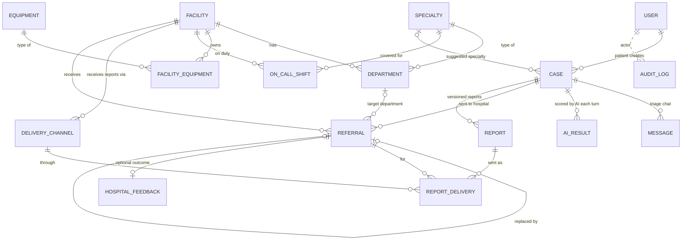
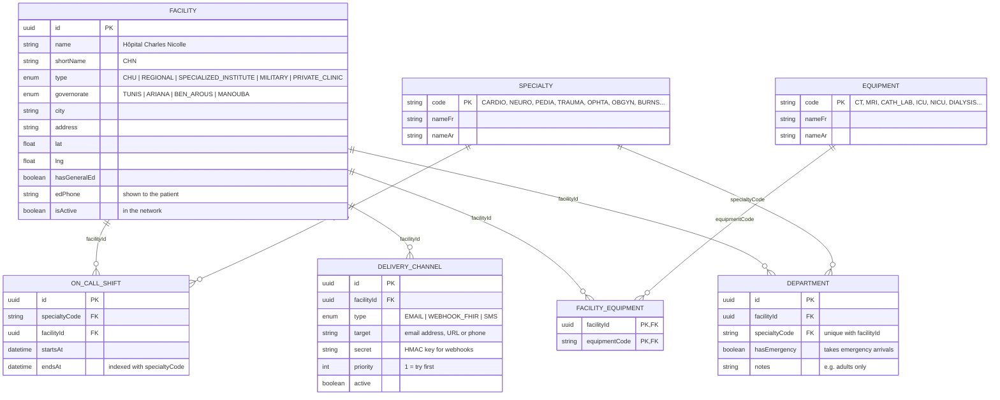
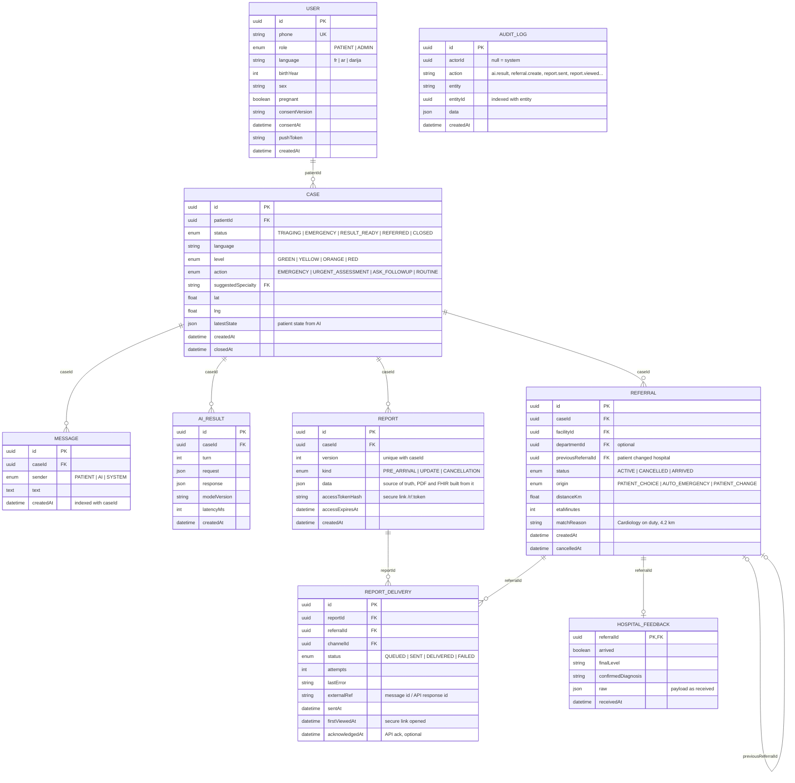
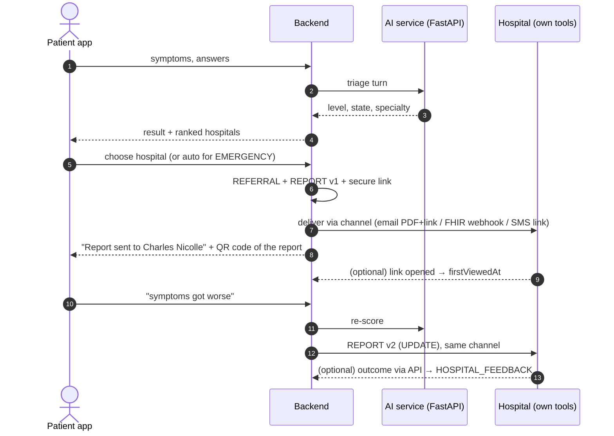
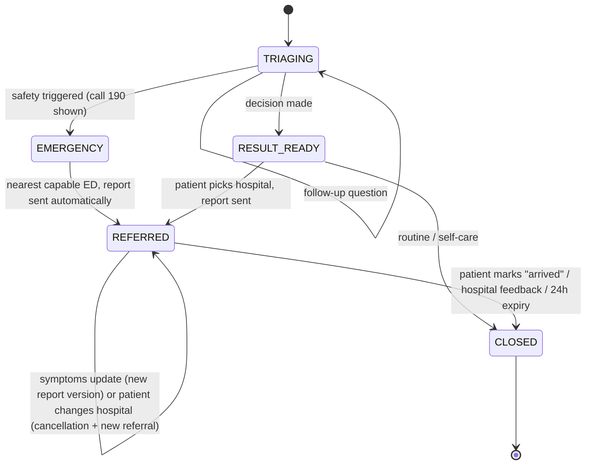

# Database Schema — Grand Tunis referral network

PostgreSQL schema for the triage app.

**The model:** the app triages the patient and picks the right hospital among all major hospitals of Grand Tunis (Tunis, Ariana, Ben Arous, Manouba). It **sends the pre-arrival report** to that hospital. The hospital then manages the patient, the case state and its staff **in its own existing tools**. The app has no doctor or hospital-staff users, no hospital dashboard and no chat.

The diagrams are Mermaid. They render on GitHub, GitLab and in VS Code (with the "Markdown Preview Mermaid Support" extension).

---

## 1. Who is in the database

| Actor | In our DB? | How they interact |
|---|---|---|
| Patient | yes (`USER`, role PATIENT) | mobile app |
| Our team (admin) | yes (`USER`, role ADMIN) | admin console / Prisma Studio: hospital directory, delivery channels, on-call schedule |
| Hospital | **as a directory entry** (`FACILITY` + `DELIVERY_CHANNEL`), not as users | receives reports by email / secure link / API, in its own tools |
| Doctors, nurses | **no** | assigned by the hospital in its own systems |

---

## 2. Overview: tables and relationships

Legend: a solid line is a real foreign key. A dotted line is a logical reference (an id without a DB constraint). `||` means exactly one, `|o` zero or one, and `o{` zero or many.

---

## 3. Full schema: hospital directory

This data is maintained by our team (seed + admin console). The hospitals don't log in.

## 4. Full schema: patients, cases, referrals, reports

`REFERRAL.facilityId → FACILITY`, `REFERRAL.departmentId → DEPARTMENT`, `CASE.suggestedSpecialty → SPECIALTY` and `REPORT_DELIVERY.channelId → DELIVERY_CHANNEL` connect these tables to section 3. They appear in the overview diagram.

---

## 5. How a report reaches the hospital

**The patient always carries the report too.** The app shows a QR code of the secure link plus the PDF. If an email is not read in time, the reception desk scans the QR code on arrival, so delivery never depends on one channel only.

---

## 6. Referral and case lifecycle

---

## 7. Matching (all of Grand Tunis)

For a case with `suggestedSpecialty = CARDIO`:

1. **Candidates:** every active `FACILITY`.
2. **Can treat it:** it has a `DEPARTMENT` for that specialty with `hasEmergency`, **or** it is on duty in `ON_CALL_SHIFT` for that specialty right now.
3. **Equipment:** if the AI asks for it (e.g. `CATH_LAB`), require a `FACILITY_EQUIPMENT` row.
4. **Rank:** EMERGENCY by ETA only; otherwise ETA plus small penalties (e.g. on-call only).
5. **Fallback:** if nothing matches the specialty, return the nearest `hasGeneralEd` facilities. The list is never empty.

There is no live bed capacity, because hospitals don't update anything in our system. If a hospital later offers a capacity API, add a `DEPARTMENT_STATUS` table fed by it.

---

## 8. Seed data: Grand Tunis hospitals (candidates, verify before use)

| Facility | Type | Governorate | Notable for |
|---|---|---|---|
| Hôpital Charles Nicolle | CHU | Tunis | general ED, many specialties |
| Hôpital La Rabta | CHU | Tunis | general ED, cardiology |
| Hôpital Habib Thameur | CHU | Tunis | general ED |
| Hôpital Mongi Slim (La Marsa) | CHU | Tunis | general ED, north suburbs |
| Hôpital d'Enfants Béchir Hamza | CHU | Tunis | pediatrics |
| Centre de Traumatologie et des Grands Brûlés | Specialized | Ben Arous | trauma, burns |
| Institut National de Neurologie Mongi Ben Hamida | Specialized | Tunis | neurology / stroke |
| Institut Hédi Rais d'Ophtalmologie | Specialized | Tunis | ophthalmology |
| Hôpital Abderrahmen Mami | CHU | Ariana | pneumology / respiratory |
| Hôpital Militaire Principal d'Instruction de Tunis | Military | Tunis | general ED |
| Centre de Maternité et de Néonatologie de Tunis | Specialized | Tunis | obstetrics, neonatology |

For the demo, point each hospital's `DELIVERY_CHANNEL` at **team email addresses** (or a Mailtrap inbox), never at the real hospitals.

---

## 9. Design notes

- **`REFERRAL`, not "handoff".** The hospital doesn't accept or reject in our system. A referral is simply "this case was sent to this hospital". If the patient changes hospital, the old referral is cancelled (and a CANCELLATION report is sent), and a new one points back to it.
- **`REPORT_DELIVERY` is the core of the integration.** It holds one row per report, per channel, per attempt cycle, with its status and errors. This table shows whether the hospital actually received the report.
- **Secure link:** only a **hash** of the token is stored. The link expires (e.g. after 24 h). Opening it sets `firstViewedAt`, a passive "the hospital saw it" signal with no action required from the hospital.
- **`HOSPITAL_FEEDBACK` is optional.** It is filled only if a hospital sends outcomes back through an API. Without it, the feedback loop (step 16) has no ground truth: see the open questions in `app-spec.md`.
- **Reports are append-only.** Every change creates a new version and a new delivery.
- **The triage chat is the only chat** (`MESSAGE` = patient ↔ AI).
- **Indexes:** `DEPARTMENT(facilityId, specialtyCode)` unique, `ON_CALL_SHIFT(specialtyCode, startsAt, endsAt)`, `REPORT_DELIVERY(status, attempts)` for the retry job, `MESSAGE(caseId, createdAt)`, `AUDIT_LOG(entity, entityId)`.
