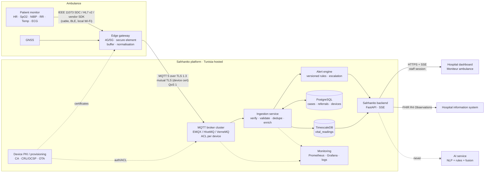
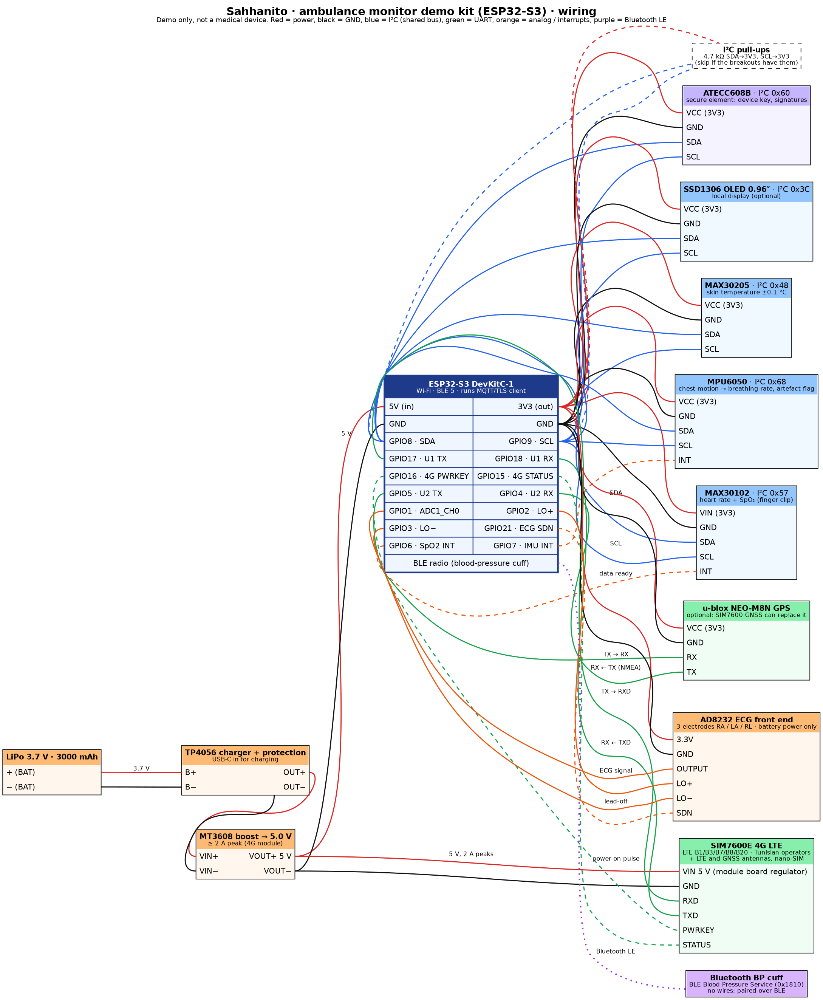

# Sahhanito IoT: ambulance monitoring, from simulation to real deployment

**Scope:** vital signs and position of a patient inside an ambulance, streamed live to the hospital that will receive them.
**Principle (kept from the prototype):** IoT data is **shown and alerted, never used by the AI** for detection or classification. The urgency level stays the decision of the NLP model + rule engine + fusion, reviewed by clinicians.

---

## 1. What we built (prototype) and what replaces it

| Prototype (today) | Real deployment |
|---|---|
| `iot-sim/iot_sim.py` invents vitals per ambulance | Certified patient monitor / defibrillator in each ambulance (e.g. Corpuls, ZOLL, Mindray, Philips) |
| The simulator is also the "gateway" | Rugged in-vehicle gateway (4G/5G router + edge agent) connected to the monitor |
| HTTPS `POST /api/v1/iot/telemetry`, one request per reading | **MQTT over TLS** (persistent connection, QoS 1, offline buffering) |
| Per-device key = `HMAC(IOT_KEY, deviceId)`, HMAC-signed JSON | **Per-device X.509 certificate** (mutual TLS), private key in a secure element / TPM |
| Gateway token from the same master key | Broker ACLs per certificate: a device may only publish to its own topics |
| Timestamp + increasing `seq` checked in backend memory | Same checks, with state in Redis (several ingestion instances) |
| `vital_readings` table (SQL, JSON column) | **TimescaleDB** hypertable (PostgreSQL extension), retention and downsampling policies |
| Dashboard polls `/staff/referrals/{id}/vitals` every 5 s | Push over the existing SSE stream (or WebSocket); polling stays as fallback |
| Thresholds hard-coded in `app/iot.py` | Alert rules versioned and clinically validated, per age group, with acknowledgement |
| Monitor bound to a simulated ambulance | Monitor bound to a real vehicle, crew and mission via the dispatch system (SAMU 190) |

---

## 2. Target architecture



**Data path:** monitor → gateway (normalise, timestamp, buffer) → MQTT broker (mTLS, ACL) → ingestion (verify, validate, deduplicate, link to the mission) → TimescaleDB + alert engine → backend → live dashboard of the receiving hospital → optionally the hospital information system as FHIR. The AI service is deliberately not on this path.

---

## 3. Components

### 3.1 Patient monitor
- Medical device certified for pre-hospital use (CE MDR class IIa/IIb), already standard in SAMU ambulances.
- Output options, by preference: **IEEE 11073 SDC** (open standard for networked medical devices), **HL7 v2 ORU^R01** over the vendor gateway, or the **vendor SDK / cloud API**. Avoid scraping screens or unofficial protocols.
- Rates: numerics (HR, SpO2, RR, Temp) every 1–5 s; NIBP when measured; ECG waveforms only if a cardiologist needs them (high bandwidth, see §8).

### 3.2 Edge gateway (in the ambulance)
- Rugged automotive router (dual SIM: Tunisie Telecom + Ooredoo or Orange Tunisie, for coverage), GNSS, 12 V power, Linux edge agent.
- **Secure element / TPM** holds the device private key: it cannot be copied off the box.
- Agent tasks: read the monitor, convert to the Sahhanito schema (§4), add GPS and a monotonic sequence number, **buffer to disk when there is no network** (tunnels, rural roads), resend in order on reconnect, send heartbeats.
- Signed firmware with **OTA updates** (rollback if a boot fails); no inbound ports; local admin disabled.

### 3.3 MQTT broker
- Managed or self-hosted cluster (EMQX, HiveMQ, VerneMQ), at least 3 nodes, TLS 1.3 only.
- Authentication by **client certificate** (mTLS); the certificate CN = device id.
- **ACL:** `ambulance/{deviceId}/#` publish-only for that device; nothing else.
- MQTT 5 features: session expiry (survives short drops), message expiry, QoS 1 (at-least-once, deduplicated downstream by `seq`).

### 3.4 Ingestion service
Generalises today's `backend/app/iot.py`:
1. Subscribe to `ambulance/+/vitals` and `ambulance/+/status` (shared subscription, several instances).
2. Check freshness and the **sequence number** per device (state in Redis), deduplicate QoS 1 redeliveries.
3. Validate physiological ranges and units; reject and count malformed messages.
4. **Bind the device to an active mission**: device → vehicle → mission (dispatch) → referral → case. Readings without an active mission are stored as "unassigned" and never shown on a case.
5. Write to TimescaleDB, hand off to the alert engine, publish a live event to the receiving hospital.

### 3.5 Storage
- **TimescaleDB hypertable** `vital_readings(time, device_id, mission_id, referral_id, code, value, unit, quality)`, one row per observation (narrow schema: new parameters need no migration).
- Continuous aggregates (1 min) for trends; raw data kept as long as the medical record requires, then deleted or anonymised according to the retention policy (§7).
- Device registry in PostgreSQL: device id, vehicle, certificate serial, firmware, last seen, status (active / revoked).

### 3.6 Alert engine
- Rules versioned like `rules.v1.json`, **validated by clinicians**, by age group (adult / child / infant). Prototype values: SpO2 < 90 %, HR > 130 or < 45, systolic < 90, RR > 28, T ≥ 39.5 °C.
- Debounce (e.g. 2 consecutive readings) so a bad probe does not raise alarms; technical alerts (probe off, signal lost, stale data > 30 s) shown apart from clinical ones.
- Hospital acknowledgement, with audit (who saw which alert, when). Escalation if nobody acknowledges.
- Alerts **inform** the receiving team (prepare a bed, resuscitation room). They never change the triage level automatically.

### 3.7 Backend and dashboard
- The existing backend serves `/staff/referrals/{id}/vitals` (history) and pushes `iot.vitals` / `iot.alert` on the hospital's SSE stream (already in place). The dashboard card **Moniteur ambulance** shows live tiles, trends, alerts, device id and data age.
- Staff only see the readings of patients referred to **their** hospital (existing referral check), and every view is logged in the audit trail.

### 3.8 Hospital information system (optional)
Each reading exported as a **FHIR R4 `Observation`** with LOINC codes, attached to the patient's Encounter, so the hospital's own system can import them along with the case Bundle the platform already produces.

---

## 4. Message format

**Topics:** `ambulance/{deviceId}/vitals`, `ambulance/{deviceId}/status` (heartbeat, battery, probe state), `ambulance/{deviceId}/ack` (from the cloud, optional).

**Payload (JSON; CBOR if bandwidth matters):**

```json
{
  "deviceId": "MON-AMB-92",
  "missionId": "M-2026-10-11-0042",
  "seq": 1791682745123,
  "ts": "2026-10-11T02:39:05.123Z",
  "position": { "lat": 36.8065, "lng": 10.1815, "accuracyM": 8 },
  "observations": [
    { "code": "8867-4",  "value": 117, "unit": "/min",  "quality": "ok" },
    { "code": "59408-5", "value": 88,  "unit": "%",     "quality": "ok" },
    { "code": "9279-1",  "value": 26,  "unit": "/min",  "quality": "ok" },
    { "code": "8480-6",  "value": 124, "unit": "mm[Hg]", "quality": "ok" },
    { "code": "8462-4",  "value": 79,  "unit": "mm[Hg]", "quality": "ok" },
    { "code": "8310-5",  "value": 36.8, "unit": "Cel",  "quality": "ok" }
  ],
  "firmware": "gw-2.3.1"
}
```

| Measure | LOINC | UCUM unit |
|---|---|---|
| Heart rate | 8867-4 | /min |
| SpO2 (pulse oximetry) | 59408-5 | % |
| Respiratory rate | 9279-1 | /min |
| Systolic BP | 8480-6 | mm[Hg] |
| Diastolic BP | 8462-4 | mm[Hg] |
| Body temperature | 8310-5 | Cel |

With mutual TLS, the connection itself authenticates the device. Keep an application-level signature (as in the prototype) only if messages cross an untrusted relay that terminates TLS.

---

## 5. Security

| Threat | Control |
|---|---|
| Fake device sends invented vitals | mTLS with per-device certificates from the Sahhanito device CA; unknown or revoked certificates rejected by the broker |
| Stolen gateway | Private key in a secure element (not extractable); certificate revoked (CRL/OCSP) and device marked revoked in the registry |
| Device writes to another ambulance's topic | Broker ACL: publish only to `ambulance/{own id}/#` |
| Replay or reordering | Timestamp window + strictly increasing `seq` per device (Redis), deduplication of QoS 1 redeliveries |
| Eavesdropping | TLS 1.3 end to end (gateway → broker, backend → dashboard); no plain MQTT port |
| Readings shown for the wrong patient | Device ↔ mission ↔ referral binding from dispatch; readings without an active mission never attached to a case |
| Tampered firmware | Secure boot, signed OTA images, staged rollout, rollback |
| Insider browsing | Staff see only referrals of their hospital; every view audited |
| Flooding | Broker rate limits per client, payload size limit, ingestion back-pressure |

**Provisioning:** at installation, the gateway generates its key in the secure element, sends a CSR, and the device CA signs it (or the manufacturer injects a certificate at the factory). Certificates are short-lived (e.g. 1 year) with automatic renewal. Decommissioning revokes the certificate and clears the registry entry.

---

## 6. Reliability

- **No network:** the gateway buffers (e.g. 24 h on disk) and resends in order; the dashboard shows "dernière mesure il y a X s" and greys out stale data (> 30 s) instead of showing old values as live.
- **Broker / ingestion down:** broker cluster with persistent sessions; ingestion is stateless (horizontal scaling, shared subscription).
- **Clock drift:** gateways synchronised by NTP/GNSS time; the server also stores `received_at`.
- **Monitoring:** connected devices, message rate, rejections by reason, end-to-end latency (target p95 < 3 s), devices silent during an active mission (alert to the dispatch supervisor).

---

## 7. Regulation and data protection (Tunisia)

- **Personal health data:** Organic Law no. 2004-63 on personal data protection; declaration or authorisation from the **INPDP** (Instance Nationale de Protection des Données Personnelles); purpose limited to patient care; defined retention period; hosting of health data in Tunisia preferred, with agreements with the hospitals.
- **Medical devices:** the monitors are already certified medical devices. If the platform's display or alerts are used to support clinical decisions, the software itself may qualify as a medical device. Plan for the corresponding process: risk management **ISO 14971**, software lifecycle **IEC 62304**, usability **IEC 62366**.
- **Networked medical IT:** **IEC 80001-1** (risk management when connecting medical devices to IT networks); industrial/IoT security **IEC 62443**; information security **ISO 27001** for the platform.
- **Clinical governance:** alert thresholds validated by the SAMU / emergency physicians; IoT data stays out of the AI triage unless a separate clinical validation says otherwise.

---

## 8. Sizing (Grand Tunis)

- Fleet: ~50–100 ambulances; at most ~30 transporting at the same time.
- Numerics every 5 s, ~400 bytes/message → ~6 msg/s and ~2.5 KB/s for the whole fleet: a single small broker handles this; the cluster is for availability, not load.
- ECG waveforms (if added): ~250 samples/s per lead, ~2–5 KB/s per ambulance with compression. Send them only on request ("12-lead to cardiology") and store them separately (object storage).
- Storage: ~6 msg/s × 6 observations → under 1 GB/month raw with TimescaleDB compression.

---

## 9. Migration path from the prototype

1. **Keep the contract:** the dashboard card, alerts, `/staff/referrals/{id}/vitals` and the "never used by the AI" rule stay as they are.
2. Add the MQTT broker and the ingestion service; make `iot-sim` publish over MQTT with a test device CA (validates mTLS, ACLs, buffering).
3. Move readings to the narrow LOINC schema in TimescaleDB; add FHIR `Observation` export.
4. Pilot one real ambulance with its monitor's official interface (SDC, HL7 or vendor API) and a real gateway; measure latency, gaps and false alerts.
5. Clinically validate alert thresholds and the screen with SAMU and receiving EDs; INPDP declaration; data processing agreements with hospitals.
6. Roll out to the fleet; integrate the device ↔ mission binding with the dispatch system; retire `iot-sim` from production (keep it for tests and demos).

---

## 10. Hardware demo kit (prototype, not a medical device)

To show the real chain (sensor → signed message → live dashboard) with physical hardware. **Never use it on patients**: a real ambulance uses its certified monitor through a gateway (§3.1–3.2).



Source: `iot-wiring.dot` (render with `dot -Tsvg docs/iot-wiring.dot -o docs/iot-wiring.svg`).

| Part | Role | Connection | ESP32-S3 pin |
|---|---|---|---|
| ESP32-S3 DevKitC-1 | Microcontroller (Wi-Fi, BLE, TLS/MQTT client) | 5 V in from the boost converter | 5V, GND |
| LiPo 3.7 V 3000 mAh → TP4056 → MT3608 (5 V) | Battery, charging, 5 V rail | LiPo → TP4056 B+/B−, OUT → MT3608 VIN, VOUT 5 V → ESP32 + SIM7600 | — |
| MAX30102 (0x57) | Heart rate + SpO₂ | I²C + interrupt, 3V3 | SDA GPIO8, SCL GPIO9, INT GPIO6 |
| MAX30205 (0x48) | Skin temperature ±0.1 °C | I²C, 3V3 | GPIO8 / GPIO9 |
| MPU6050 (0x68) | Chest motion → breathing rate, motion-artefact flag | I²C + interrupt, 3V3 | GPIO8 / GPIO9, INT GPIO7 |
| ATECC608B (0x60) | Secure element: device private key, signatures | I²C, 3V3 | GPIO8 / GPIO9 |
| SSD1306 OLED (0x3C) | Local display (optional) | I²C, 3V3 | GPIO8 / GPIO9 |
| SIM7600E | 4G LTE (B1/B3/B7/B8/B20), MQTT/TLS uplink | UART1 (TX→RXD, RX←TXD), 5 V from the boost (2 A peaks) | TX GPIO17, RX GPIO18, PWRKEY GPIO16, STATUS GPIO15 |
| u-blox NEO-M8N | GPS (optional: the SIM7600 GNSS can replace it) | UART2, 3V3 | TX GPIO5 → RX, RX GPIO4 ← TX |
| AD8232 | One-lead ECG (3 electrodes) | Analog out + lead-off pins, 3V3 | OUTPUT GPIO1 (ADC1), LO+ GPIO2, LO− GPIO3, SDN GPIO21 |
| BLE blood-pressure cuff | Blood pressure (Blood Pressure Service 0x1810) | Bluetooth LE, no wire | BLE radio |

**Notes**
- All I²C parts share one bus; the addresses do not clash. Add 4.7 kΩ pull-ups to 3V3 on SDA and SCL unless the breakout boards already have them.
- Cross UART lines (TX → RX). Keep a common ground for everything.
- The SIM7600E draws up to 2 A in bursts: power it from the 5 V boost rail, never from the ESP32's 3V3 regulator; add a 1000 µF capacitor near its input if it resets during transmission.
- ECG safety: only attach electrodes while the kit runs on battery (no USB to a mains-powered laptop).
- The MAX30102 is sensitive to movement: flag readings taken while the MPU6050 detects motion.
- The firmware publishes the same signed message format as `iot-sim` (per-device key in the ATECC608B), so the dashboard's *Moniteur ambulance* card shows the kit's readings unchanged.
